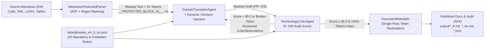

# Trilingual Technical Localization & Auditing Pipeline (`EN → FR / ES`)

[](https://www.python.org/)
[](https://docs.pydantic.dev/)
[](https://markdown-it-py.readthedocs.io/)
[](https://docs.pytest.org/)
[](LICENSE)

> **Deterministic syntax isolation + multi-agent terminology governance** for localizing complex engineering and software documentation across **English (`en`), French (`fr`), and Spanish (`es`)**—preserving **100%** of fenced/inline code, XML descriptors, and LaTeX physics equations while enforcing corporate glossaries through an automated translator-critic feedback loop (`score ≥ 95.0`).

---

## Executive Overview (EN / ES / FR)

- **English:** Translating aerospace, embedded, or software engineering specs with raw LLMs routinely corrupts Python indentation, mangles inline LaTeX (`$q'' = -k \nabla T$`), translates XML tags, and introduces false-friend terminology (*"fuite thermique"* instead of *"emballement thermique"*). This pipeline eliminates syntax corruption via deterministic Markdown AST + regex masking (`__PROTECTED_BLOCK_XX__`) and enforces corporate glossaries through a structured `DomainTranslatorAgent` ↔ `TerminologyCriticAgent` audit loop.
- **Español:** La traducción automática de documentación técnica compleja suele romper bloques de código, alterar ecuaciones LaTeX, corromper etiquetas XML e introducir calcos terminológicos prohibidos. Este sistema aísla determinísticamente **41 bloques protegidos** mediante AST de Markdown y expresiones regulares antes de traducir, y ejecuta un ciclo automático de auditoría con `TerminologyCriticAgent` (umbral `< 95.0`) que eleva la precisión terminológica del **56.0%** al **100.0%**.
- **Français :** Ce pipeline combine un préprocesseur déterministe (AST `markdown-it-py` + expressions régulières) et une boucle multi-agents (`DomainTranslatorAgent` ↔ `TerminologyCriticAgent`) pour traduire des spécifications techniques de l'anglais vers le français et l'espagnol tout en garantissant **100 % d'intégrité syntaxique** et la conformité stricte au glossaire d'entreprise (`data/glossary_en_fr_es.json`).

---

## System Architecture



### Three-Phase Pipeline Guarantees

1. **Deterministic AST + Regex Preprocessing ([`src/parser.py`](src/parser.py)):**
   - **AST Stage (`MarkdownIt("commonmark").enable("table")`):** Isolates fenced code blocks (` ```python `), indented code blocks, and XML/HTML blocks (`<telemetry-config>`).
   - **Regex Stage (strict precedence):** Isolates display LaTeX (`$$...$$`, `\[...\]`), inline code spans (`` `...` ``), XML tags/comments (`<sensor-ref ... />`, `<callout ...>`), and inline LaTeX (`$...$`, `\(...\)`) while guarding currency expressions (`$50 and $75`, `$100-$200`) and inequality comparisons (`a < b`, `x > 0`) from false masking.
   - Assigns sequential reading-order placeholders `__PROTECTED_BLOCK_01__` … `__PROTECTED_BLOCK_NN__` with exact source line spans.
2. **Multi-Agent Translation & Terminology Audit Loop ([`src/swarm_translator.py`](src/swarm_translator.py)):**
   - **`DomainTranslatorAgent`:** Dynamically detects applicable glossary terms in masked prose and injects mandatory target terms + forbidden variants into the system prompt.
   - **`TerminologyCriticAgent`:** Audits protected token integrity (`TOKEN_MISSING`, `TOKEN_DUPLICATED`, `TOKEN_CORRUPTED`), corporate glossary compliance (`FORBIDDEN_TERM_USED`, `UNTRANSLATED_TERM`, `MANDATORY_TERM_MISSING`), and Markdown heading/table parity, emitting a **0–100** `CriticReport`. Whenever `score < 95.0` or any token is damaged, an automatic revision cycle feeds structured observations back to `DomainTranslatorAgent`.
3. **Single-Pass Rebuilder ([`src/rebuilder.py`](src/rebuilder.py)):**
   - Validates 1:1 token bijection (`validate_tokens`) and restores all protected blocks in a **single non-recursive `re.sub` pass**, preventing nested token expansion if code blocks contain literal `__PROTECTED_BLOCK_XX__` strings, then verifies verbatim syntax integrity (`verify_syntax_integrity`).

---

## Quantitative Evaluation: Before vs. After `TerminologyCriticAgent`

Measured by running [`scripts/evaluate_pipeline.py`](scripts/evaluate_pipeline.py) on [`data/sample_engineering_doc_en.md`](data/sample_engineering_doc_en.md) (**804 words**, **41 protected blocks**, **2 Markdown tables**, **2 Python code blocks**, **XML descriptors**, **LaTeX equations**, and **25 glossary terms** from [`data/glossary_en_fr_es.json`](data/glossary_en_fr_es.json)):

| Target Language | Glossary Terms | Critic Score (Before → After) | Terminology Precision (Before → After) | Forbidden Terms (Before → After) | Protected Token Integrity | Iterations |
| :--- | :---: | :---: | :---: | :---: | :---: | :---: |
| **FR** | 25 | 18.0 → **100.0** (+82.0) | 56.0% → **100.0%** (+44.0 pp) | 9 → **0** | 100.0% → **100.0%** | 2 |
| **ES** | 25 | 18.0 → **100.0** (+82.0) | 56.0% → **100.0%** (+44.0 pp) | 9 → **0** | 100.0% → **100.0%** | 2 |
| **Aggregate (FR + ES)** | 25 | 18.0 → **100.0** (+82.0) | 56.0% → **100.0%** (+44.0 pp) | 18 → **0** | 100.0% → **100.0%** | 2 |

Full per-iteration machine-readable audit traces are exported to [`output/translation_audit_report.json`](output/translation_audit_report.json) and [`output/eval_benchmark_report.json`](output/eval_benchmark_report.json).

---

## Repository Structure

```text
trilingual-tech-localization-pipeline/
├── data/
│   ├── glossary_en_fr_es.json            # 25-term corporate aerospace/software glossary (EN/FR/ES)
│   └── sample_engineering_doc_en.md      # ~800-word technical spec with code, LaTeX, XML & tables
├── output/
│   ├── sample_engineering_doc_fr.md      # Audited & rebuilt French publication output
│   ├── sample_engineering_doc_es.md      # Audited & rebuilt Spanish publication output
│   ├── translation_audit_report.json     # Per-iteration critic scores & observations
│   └── eval_benchmark_report.json        # Before vs. after benchmark metrics
├── scripts/
│   └── evaluate_pipeline.py              # Quantitative before/after critic benchmark runner
├── src/
│   ├── __init__.py                       # Public package exports
│   ├── models.py                         # Pydantic v2 schemas & audit models
│   ├── parser.py                         # Deterministic AST + regex protected-block extractor
│   ├── glossary.py                       # Glossary loader, inflection-aware matcher & prompt rules
│   ├── backends.py                       # Deterministic offline engine + OpenAI/Gemini/Anthropic adapters
│   ├── swarm_translator.py               # DomainTranslatorAgent, TerminologyCriticAgent, LocalizationSwarm
│   ├── rebuilder.py                      # Single-pass DocumentRebuilder & syntax integrity verifier
│   └── pipeline.py                       # Typer + Rich CLI (`translate`, `evaluate`)
├── tests/
│   ├── conftest.py                       # Shared pytest fixtures
│   ├── test_parser.py                    # AST, regex precedence, currency & round-trip tests
│   ├── test_rebuilder.py                 # Single-pass non-recursive restoration & export tests
│   ├── test_swarm_translator.py          # Glossary, critic scoring & auto-correction loop tests
│   └── test_eval_and_e2e.py              # Dataset coverage & end-to-end benchmark tests
├── .gitignore
├── LICENSE
├── pyproject.toml
├── requirements.txt
└── README.md
```

---

## Installation & Usage

### Prerequisites

- **Python 3.11+** (verified on Python 3.12.8)
- Install core and test dependencies:

```powershell
pip install -r requirements.txt
```

### Run the Benchmark Evaluation

```powershell
python scripts/evaluate_pipeline.py
```

Or via the Typer CLI:

```powershell
python -m src.pipeline evaluate
```

### Translate a Document (`EN → FR / ES`)

**Offline deterministic engine (zero API keys required):**

```powershell
python -m src.pipeline translate --input data/sample_engineering_doc_en.md --lang fr --lang es --backend deterministic
```

**Production LLM providers (`openai`, `gemini`, or `anthropic`):**

Install optional SDKs (`pip install -e ".[llm]"`), set your API key (`OPENAI_API_KEY`, `GEMINI_API_KEY`, or `ANTHROPIC_API_KEY`), and select `--backend`:

```powershell
$env:OPENAI_API_KEY="sk-..."
python -m src.pipeline translate --input data/sample_engineering_doc_en.md --lang fr --lang es --backend openai
```

### Run the Test Suite

```powershell
python -m pytest -v
```

---

## Sample Critic Audit Trace (`output/translation_audit_report.json`)

```json
{
  "target_language": "fr",
  "final_score": 100.0,
  "passed": true,
  "syntax_integrity_verified": true,
  "protected_blocks_count": 41,
  "iterations": [
    {
      "iteration": 1,
      "score": 18.0,
      "passed": false,
      "token_integrity_rate": 100.0,
      "terminology_precision": 56.0,
      "forbidden_terms_found": 9
    },
    {
      "iteration": 2,
      "score": 100.0,
      "passed": true,
      "token_integrity_rate": 100.0,
      "terminology_precision": 100.0,
      "forbidden_terms_found": 0
    }
  ]
}
```
